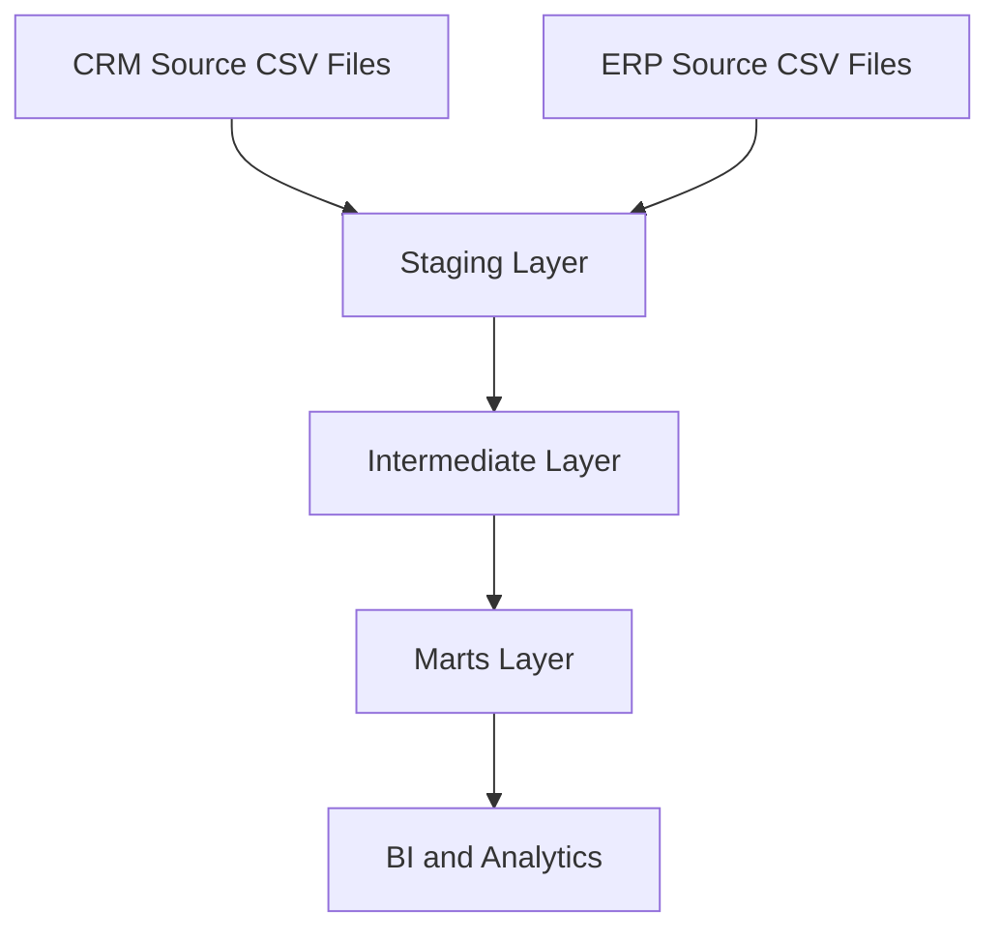

# SQL Data Warehouse Project

## Overview

This project demonstrates the end-to-end development of a **SQL Data Warehouse** using Microsoft SQL Server.

The goal is to build a structured data warehouse that integrates data from CRM and ERP source systems, transforms raw data into reliable datasets, and provides business-ready information for analytics and reporting.

The project implements a three-layer data architecture:

1. **Staging Layer** — Raw data ingestion.
2. **Intermediate Layer** — Data cleaning and transformation.
3. **Marts Layer** — Business-ready dimensional modeling.

The final analytical model follows a **Star Schema**, consisting of customer and product dimensions connected to a sales fact view.

This is a hands-on learning project focused on understanding practical Data Engineering, Data Architecture, ETL, SQL, and Data Warehousing concepts.

---

## Project Objectives

The main objectives are to:

- Design and implement a Data Warehouse using SQL Server.
- Integrate data from multiple source systems (CRM and ERP).
- Build ETL processes using SQL Stored Procedures.
- Perform data cleaning, standardization, and transformation.
- Apply data quality checks to improve data reliability.
- Implement dimensional modeling using a Star Schema.
- Create Fact and Dimension views for analytical reporting.
- Prepare business-ready datasets for BI tools and dashboards.
- Practice SQL development, documentation, and version control using GitHub.

---

## Data Warehouse Architecture

The project uses a layered architecture inspired by the Medallion Architecture.

The layer names have been customized as follows:

| Medallion Architecture | Project Schema | Purpose |
|---|---|---|
| Bronze | `staging` | Raw Data |
| Silver | `intermediate` | Cleaned and Transformed Data |
| Gold | `marts` | Business-Ready Data |

### Data Flow



Each layer has a specific responsibility to ensure separation between raw data, transformation logic, and business reporting.

---

## Database Structure

**Database Name:**

```text
DataWarehouse
```

**Database Management System:**

```text
Microsoft SQL Server
```

**Schemas:**

```text
staging
intermediate
marts
```

### Schema Responsibilities

| Schema | Responsibility |
|---|---|
| `staging` | Stores raw data extracted from source systems. |
| `intermediate` | Contains cleaned, validated, and transformed datasets. |
| `marts` | Provides business-ready Fact and Dimension views. |

---

## 1. Staging Layer

**Schema:** `staging`

### Purpose

The Staging Layer serves as the initial landing area for data extracted from external source systems.

Data is loaded from CSV files into SQL Server using the `BULK INSERT` command.

The objective is to preserve source data as closely as practical before applying cleaning and transformation rules.

### Source Systems

The project integrates two source systems:

**CRM — Customer Relationship Management**

Contains information related to:

- Customers
- Products
- Sales Transactions

**ERP — Enterprise Resource Planning**

Contains additional information related to:

- Customer Demographics
- Customer Locations
- Product Categories

### Staging Tables

| Table Name | Source | Description |
|---|---|---|
| `staging.crm_cust_info` | CRM | Raw customer information. |
| `staging.crm_prd_info` | CRM | Raw product information. |
| `staging.crm_sales_details` | CRM | Raw sales transactions. |
| `staging.erp_cust_az12` | ERP | Customer demographics and birth dates. |
| `staging.erp_loc_a101` | ERP | Customer geographical information. |
| `staging.erp_px_cat_g1v2` | ERP | Product categories and subcategories. |

### Data Ingestion

The project uses a SQL Server Stored Procedure:

```sql
EXEC staging.load_staging;
```

The procedure performs the following operations:

1. Starts the loading process.
2. Clears existing staging data using `TRUNCATE TABLE`.
3. Loads CRM data using `BULK INSERT`.
4. Loads ERP data using `BULK INSERT`.
5. Displays execution progress using `PRINT`.
6. Measures loading duration.
7. Handles supported runtime errors using `TRY...CATCH`.

### Loading Strategy

The Staging Layer uses a **Full Refresh** strategy.

```sql
TRUNCATE TABLE staging.crm_cust_info;

BULK INSERT staging.crm_cust_info
FROM 'C:\path\to\source_crm\cust_info.csv'
WITH (
    FIRSTROW = 2,
    FIELDTERMINATOR = ',',
    TABLOCK
);
```

Existing rows are removed before new data is loaded.

**Important:** The `TRUNCATE` operation removes all existing rows. CSV paths must be configured for the machine running SQL Server, and SQL Server must have permission to access them.

### Initial Data Loading Results

The following counts were observed during the initial staging validation:

| Table | Records |
|---|---:|
| crm_cust_info | 18,493 |
| crm_prd_info | 397 |
| crm_sales_details | 60,398 |
| erp_cust_az12 | 18,483 |
| erp_loc_a101 | 18,484 |
| erp_px_cat_g1v2 | 37 |
| **Total** | **116,292** |

These counts represent a recorded validation snapshot and should be rechecked after subsequent data loads.

---

## 2. Intermediate Layer

**Schema:** `intermediate`

### Purpose

The Intermediate Layer transforms raw data into cleaned, standardized, and structured datasets.

It applies data quality rules, handles inconsistent values, resolves duplicate records, and prepares information for dimensional modeling.

### Intermediate Tables

| Table Name | Description |
|---|---|
| `intermediate.crm_cust_info` | Cleaned customer information. |
| `intermediate.crm_prd_info` | Standardized product information. |
| `intermediate.crm_sales_details` | Cleaned sales transactions. |
| `intermediate.erp_cust_az12` | Standardized customer demographics. |
| `intermediate.erp_loc_a101` | Standardized customer locations. |
| `intermediate.erp_px_cat_g1v2` | ERP product categories. |

### Data Transformations

#### Customer Data

Transformations include:

- Removing duplicate customer records using `ROW_NUMBER()`.
- Retaining the most recent record based on customer creation date.
- Removing unnecessary spaces using `TRIM()`.
- Standardizing marital status.
- Standardizing gender values.
- Excluding records with missing customer IDs.

#### Product Data

Transformations include:

- Extracting category identifiers using `SUBSTRING()`.
- Standardizing category identifiers using `REPLACE()`.
- Separating product numbers from composite product keys.
- Replacing missing product costs with zero according to the project rule.
- Standardizing product line descriptions using `CASE`.
- Calculating product record end dates using `LEAD()`.

#### Sales Data

Transformations include:

- Converting source date values into SQL `DATE` values.
- Handling missing or invalid dates.
- Applying business rules to sales amounts.
- Correcting invalid or missing price values where sufficient source information exists.
- Protecting calculations from division by zero using `NULLIF()`.

#### ERP Customer Data

Transformations include:

- Removing the `NAS` prefix from customer identifiers.
- Standardizing gender values.
- Handling future birth dates according to the cleaning rules.

#### ERP Location Data

Transformations include:

- Removing hyphens from customer identifiers.
- Standardizing country names.
- Converting `DE` to `Germany`.
- Converting `US` and `USA` to `United States`.
- Handling missing country values.

### Data Loading

The Intermediate Layer is loaded using:

```sql
EXEC intermediate.load_intermediate;
```

The Stored Procedure performs:

1. Truncation of existing intermediate tables.
2. Extraction of data from staging tables.
3. Data cleaning and transformation.
4. Insertion of transformed records.
5. Execution progress monitoring.
6. Per-table loading duration measurements.
7. Total batch execution time measurement.
8. Basic error handling.

### Technical Metadata

Intermediate tables include:

```sql
dwh_create_date DATETIME2 DEFAULT GETDATE()
```

This column records when data is inserted into the Intermediate Layer, provided the insert does not explicitly supply another value.

---

## 3. Marts Layer

**Schema:** `marts`

### Purpose

The Marts Layer provides business-ready datasets designed for analytical queries, business intelligence, and reporting.

The layer uses a dimensional model based on a **Star Schema**.

It includes two Dimension Views and one Fact View.

### Marts Views

| View Name | Type | Description |
|---|---|---|
| `marts.dim_customers` | Dimension | Customer attributes and demographic information. |
| `marts.dim_products` | Dimension | Current product attributes and classifications. |
| `marts.fact_sales` | Fact | Sales transactions and business measures. |

### Customer Dimension

**View:** `marts.dim_customers`

Combines customer data from CRM and ERP.

Includes:

- Customer Key
- Customer ID
- Customer Number
- First Name
- Last Name
- Country
- Marital Status
- Gender
- Birthdate
- Customer Creation Date

The view uses `LEFT JOIN` to enrich CRM customer records with demographic and geographical information from ERP.

### Product Dimension

**View:** `marts.dim_products`

Combines CRM product information with ERP product categories.

Includes:

- Product Key
- Product ID
- Product Number
- Product Name
- Category ID
- Category
- Subcategory
- Maintenance
- Cost
- Product Line
- Start Date

The view includes current product records using:

```sql
WHERE prd_end_dt IS NULL
```

During an earlier validation, 295 current product records were observed with 295 distinct product numbers.

### Sales Fact

**View:** `marts.fact_sales`

Contains sales transactions with references to customer and product dimensions.

Includes:

- Order Number
- Product Key
- Customer Key
- Order Date
- Shipping Date
- Due Date
- Sales Amount
- Sales Quantity (`sls_quantity`)
- Price

### Star Schema Relationships

| Fact Column | Dimension Column | Relationship |
|---|---|---|
| `fact_sales.customer_key` | `dim_customers.customer_key` | Many-to-One |
| `fact_sales.product_key` | `dim_products.product_key` | Many-to-One |

The model supports analytical queries across customers, products, and sales.

**Technical Note:** The current dimension keys are generated using `ROW_NUMBER()` inside regular views. They are logical identifiers, not guaranteed to be stable across source data changes. Persistent surrogate keys should be considered for production implementations.

---

## Data Modeling Concepts

### Fact Tables

Fact tables represent measurable business events.

In this project, the Sales Fact represents sales order lines.

Typical measures include:

- Sales Amount
- Quantity Sold
- Unit Price

### Dimension Tables

Dimension tables contain descriptive attributes used to analyze facts.

Examples include:

- Customer Name
- Country
- Product Name
- Product Category
- Product Line

### Grain

The grain defines what one record represents.

| View | Grain |
|---|---|
| `dim_customers` | One current customer record, assuming unique joins. |
| `dim_products` | One current product record, assuming unique joins. |
| `fact_sales` | One sales order line. |

A customer may appear in multiple sales records while maintaining one current customer dimension record.

Similarly, a product may appear in multiple sales transactions.

---

## Data Quality Validation

Data quality checks are necessary to ensure that transformed information remains reliable.

### Key Validation Checks

- Verify row counts between layers.
- Identify missing customer and product keys.
- Detect duplicate business identifiers.
- Validate date values.
- Check invalid or missing sales amounts.
- Verify source-to-target transformations.
- Validate joins between facts and dimensions.
- Identify unexpected record multiplication.

### Example 1: Product Key Uniqueness

```sql
SELECT
    COUNT(*) AS total_records,
    COUNT(DISTINCT prd_key) AS unique_products
FROM intermediate.crm_prd_info
WHERE prd_end_dt IS NULL;
```

### Example 2: Unmatched Sales Records

```sql
SELECT
    COUNT(*) AS total_sales,

    SUM(
        CASE WHEN product_key IS NULL
        THEN 1 ELSE 0 END
    ) AS missing_products,

    SUM(
        CASE WHEN customer_key IS NULL
        THEN 1 ELSE 0 END
    ) AS missing_customers

FROM marts.fact_sales;
```

### Example 3: Duplicate Customer Identifiers

```sql
SELECT
    Customer_id,
    COUNT(*) AS duplicate_count
FROM marts.dim_customers
GROUP BY Customer_id
HAVING COUNT(*) > 1;
```

### Data Quality Principles

1. Understand the grain before joining tables.
2. Do not assume that joins preserve row counts.
3. Validate duplicates before removing them.
4. Preserve raw source information in staging.
5. Apply transformations using defined business rules.
6. Verify calculated metrics against source information.
7. Check for unmatched dimension records.
8. Document transformation assumptions and known limitations.

---

## Project Repository Structure

The following structure organizes SQL scripts by data warehouse layer.

```text
sql-data-warehouse-project/
│
├── README.md
│
├── scripts/
│   ├── staging/
│   │   ├── ddl_staging.sql
│   │   └── proc_load_staging.sql
│   │
│   ├── intermediate/
│   │   ├── ddl_intermediate.sql
│   │   └── proc_load_intermediate.sql
│   │
│   └── gold/
│       └── ddl_gold.sql
│
└── docs/
    └── data_catalog.md
```

This is a suggested organization; file paths should match the actual repository.

The `gold` folder name is retained in this example, while the corresponding SQL Server schema is named `marts`.

---

## Getting Started

### Prerequisites

- Microsoft SQL Server
- SQL Server Management Studio or DBeaver
- CRM and ERP source CSV files
- Access permissions for SQL Server to read source files

### Step 1: Prepare the Database

Create or select the `DataWarehouse` database and ensure these schemas exist:

```sql
CREATE SCHEMA staging;
GO

CREATE SCHEMA intermediate;
GO

CREATE SCHEMA marts;
GO
```

These commands are intended for initial setup. Do not recreate schemas that already exist.

### Step 2: Create Staging Tables

Run the Staging DDL script to create the six source tables.

### Step 3: Load Staging Data

Execute:

```sql
EXEC staging.load_staging;
```

Confirm the loaded row counts and inspect representative records.

### Step 4: Create Intermediate Tables

Run the Intermediate DDL script.

### Step 5: Load Intermediate Data

Execute:

```sql
EXEC intermediate.load_intermediate;
```

Validate the transformations and data quality.

### Step 6: Create Marts Views

Create the views in dependency order:

1. `marts.dim_customers`
2. `marts.dim_products`
3. `marts.fact_sales`

Use separate SQL Server batches for each `CREATE VIEW` statement.

### Step 7: Validate the Analytical Model

```sql
SELECT *
FROM marts.dim_customers;

SELECT *
FROM marts.dim_products;

SELECT *
FROM marts.fact_sales;
```

Validate row counts, key uniqueness, and relationships before consuming the data.

**Warning:** Some project scripts use `DROP TABLE` or `TRUNCATE TABLE`. Running them may permanently replace existing table data. Review each script before execution.

---

## Analytics and Reporting

The Marts Layer can support analytical reporting such as:

- Total Sales Revenue
- Total Quantity Sold
- Sales by Customer
- Sales by Country
- Sales by Product
- Sales by Category
- Sales by Product Line
- Sales Trends Over Time

These datasets can be consumed by BI tools such as Power BI, Metabase, and other SQL-compatible reporting applications.

---

## Tools and Technologies

| Technology | Purpose |
|---|---|
| Microsoft SQL Server | Data Warehouse database |
| T-SQL | Data extraction, transformation, and modeling |
| SSMS | Database development and execution |
| DBeaver | SQL development and data inspection |
| CSV Files | CRM and ERP source datasets |
| Git and GitHub | Version control and documentation |
| Power BI / Metabase | Potential analytical reporting tools |

---

## Project Status

### Completed or Implemented

- [x] Data Warehouse architecture defined
- [x] Database schemas created
- [x] Six Staging tables created
- [x] CRM and ERP CSV ingestion implemented
- [x] Staging loading Stored Procedure created
- [x] Intermediate tables created
- [x] Data cleaning and transformations implemented
- [x] Intermediate loading Stored Procedure created
- [x] Customer Dimension View defined
- [x] Product Dimension View defined
- [x] Sales Fact View defined
- [x] Initial row-count and product-key validation performed

### Further Improvements

- [ ] Complete automated Data Quality tests
- [ ] Validate all fact-to-dimension relationships
- [ ] Improve error handling and execution logging
- [ ] Introduce transaction management where appropriate
- [ ] Implement persistent surrogate keys
- [ ] Improve historical data handling
- [ ] Build an analytical dashboard
- [ ] Test the end-to-end pipeline after each change

---

## Key Learning Outcomes

Through this project, the following concepts are practiced:

- Data Warehouse Architecture
- Layered Data Architecture
- SQL DDL and DML
- Database Schemas
- Stored Procedures
- Data Ingestion
- ETL Pipelines
- Data Cleaning
- Data Transformation
- Window Functions
- Data Quality Validation
- Dimensional Modeling
- Fact and Dimension Tables
- Star Schema
- Business Keys and Surrogate Keys
- SQL Joins and Relationships

---

## Project Reference

This learning project follows the SQL Data Warehouse tutorial by **Data With Baraa**, with customized schema names and project documentation.

Tutorial:

https://www.youtube.com/watch?v=9GVqKuTVANE

The project is developed for educational purposes, with additional technical review and validation as part of the learning process.

---

## Long-Term Goal

The long-term objective is to develop the knowledge and practical skills required to design and build reliable, maintainable, and scalable analytical data systems.

The project establishes a foundation for future learning in:

- Advanced Data Engineering
- ETL and ELT Orchestration
- Data Quality Automation
- Data Modeling
- Data Governance
- Analytical Reporting
- Production Data Warehouse Design


